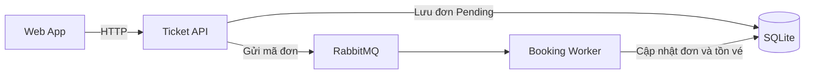

# Tuần 1 · Hệ thống đặt vé sự kiện phân tán

**Dương Quốc Huy · dtc245200173 · CNTT K23D**

## Bài toán

Người dùng xem sự kiện và số vé còn lại, gửi yêu cầu đặt vé, sau đó tra cứu trạng thái từng đơn hoặc lịch sử theo mã người dùng. Đơn mới có trạng thái `Pending`. Worker xác nhận và trừ vé khi đủ tồn kho hoặc từ chối khi số vé còn lại không đủ.

## Thiết kế dự kiến

Dùng C# và .NET 10 cho Ticket API và Booking Worker, Web App làm client, SQLite lưu dữ liệu, RabbitMQ truyền yêu cầu xử lý bất đồng bộ.

Dữ liệu dự kiến gồm `Events` (mã, tên, địa điểm, vé còn lại) và `Bookings` (mã đơn, mã sự kiện, mã người đặt, số lượng, trạng thái). Worker sẽ trừ tồn vé và cập nhật trạng thái trong cùng một giao dịch.

## Kế hoạch đề xuất theo tuần

| Tuần | Phần thực hiện | Kết quả cần kiểm tra |
|---|---|---|
| 1 | Phân tích yêu cầu và phác thảo kiến trúc | Xác định dữ liệu, trạng thái và luồng giao tiếp |
| 2 | Tạo Ticket API và dữ liệu mẫu | Gọi được `GET /events` và `GET /events/{id}` |
| 3 | Thêm SQLite và nghiệp vụ tiếp nhận đơn | `POST /bookings` trả `202 Pending`, có thể tra cứu đơn và lịch sử |
| 4 | Kết nối RabbitMQ từ API | Đơn mới có message trong hàng đợi |
| 5 | Thêm Booking Worker và giao dịch tồn kho | Đủ vé thì Confirmed, thiếu vé thì Rejected |
| 6 | Làm Web App | Xem sự kiện, gửi đơn và tra cứu bằng trình duyệt |
| 7 | Ghép Docker Compose và kiểm tra phục hồi | Khởi động cả hệ thống, dừng và bật lại Worker hoặc RabbitMQ |
| 8 | Kiểm thử tổng hợp, hoàn thiện báo cáo và demo | Chạy lại các luồng chính và ghi kết quả thực tế |

Phạm vi Tuần 1 là tài liệu phân tích và thiết kế. Các tuần sau bổ sung dần mã nguồn theo kế hoạch và yêu cầu từng tuần của giảng viên.
